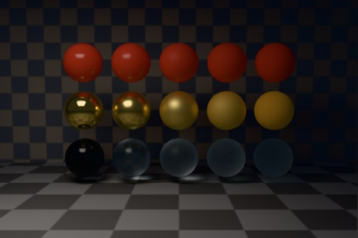

# Materials

How surfaces are described and rendered: the split between BSDFs and integrators, the physically based
`PrincipledMaterial`, the microfacet theory behind it, the GPU port, and how all of it is tested.

<p align="center"></p>
<p align="center"><sub><code>tests/pbr_materials</code> on the GPU: plastic, gold and glass, roughness increasing to the right.</sub></p>

## Materials describe; integrators transport

A material answers one question: at this hit, what does the surface emit, and how does it scatter light?

```js
material.surface(data)  // -> { emission: Vec or null, bsdf: BSDF or null }
```

`data` comes from `Primitive.surfaceData` (ray, position, normal, UV). Materials never cast rays. Everything about
light transport is in `src/integrators.js`:

- **`WhittedIntegrator`**: direct light from every light at every hit, plus recursion along every perfectly specular
  direction (mirrors, refraction, pass-through transparency). With the legacy Phong materials it reproduces the
  original renderer: 11 deterministic scenes (including the mesh scenes AMultipleBVH, diamond and cat) match pixel
  for pixel, apart from 3 of 4,096 pixels on one refraction edge (double precision instead of float32 in the
  refraction direction).
- **`PathIntegrator`**: unbiased path tracing. At every hit it samples every light (next-event estimation), weighs that
  against the chance that the BSDF would have found the same light (multiple importance sampling with the power
  heuristic), continues in one BSDF-sampled direction, and ends dim paths with Russian roulette.

Renderers take an `integrator` option: `"whitted"`, `"path"` or `"auto"` (the default, which path traces when any
material's `prefersPathTracing` is true). Every existing scene renders in the mode it was designed for.

### The BSDF interface

`src/bsdf.js`. A BSDF is a weighted mix of lobes at one shading point. Each lobe works in a local frame where the
normal is +z:

| Method | Returns |
|---|---|
| `eval(wo, wi)` | f(wo, wi). The integrator multiplies by abs(cos theta_i) itself. |
| `sample(wo, u1, u2)` | A direction wi and the density it was drawn with, or a delta direction with its weight |
| `pdf(wo, wi)` | The density `sample` produces wi with, per unit solid angle |

Delta lobes (`MirrorLobe`, `PassThroughLobe`, `SmoothDielectricLobe`) scatter into single directions; `eval` and
`pdf` ignore them, and Whitted mode traces all of them through `deltaDirections`. A non-delta sample is weighted by
the whole mixture (the sum of every lobe's f and pdf), which is MIS between the lobes with the balance heuristic.

### Light units

A light's `color * intensity` is the total power it emits, Phi, and both integrators use the same physical units:

- A point light emits Phi equally in every direction, so a surface facing it at distance d receives irradiance
  `Phi / (4 pi d^2)`.
- An area light emits from both sides of its surface, evenly over its area A, as a Lambertian emitter. Its radiance
  is `Le = Phi / (2 pi A)`, which is also what a ray that hits it sees, so a visible light always matches the light it
  casts.

The original renderer used a different convention. Direct light was `kd * E` (E the irradiance), but bounced light
was weighted by `kd`, which under cosine sampling means a BRDF of `kd / pi`, so direct light was pi times too strong
relative to indirect light. Area lights were also treated as emitting `Phi / (4 pi)` per steradian like point lights,
half of what a two-sided emitter of that power gives.

The path-traced scenes were retuned to keep the brightness they were designed with (point lights times pi, area
lights times pi / 2), and the area-lit Whitted scenes (`cornell_box`, `heart`, `starwars`, `tie_fighter`, `x-wing`)
halved their area lights. Whitted mode keeps the original Phong formulas through `BSDF.whittedDirect`, so those
scenes render as before; any other BSDF uses the physical `f * cos` in both modes.

### The legacy materials as BSDFs

| Material | Lobes |
|---|---|
| `PhongMaterial` | Lambertian (diffusivity), normalized Phong (specularity), mirror (reflectivity), pass-through (transmissivity); ambient is emission |
| `FresnelPhongMaterial` | The same rough lobes on both sides of a Fresnel split, plus a smooth dielectric |
| `PhongPathTracingMaterial` | A mixture that matches the old sampler: a mirror with `mirrorProbability`, otherwise diffuse and glossy in proportion to their strengths |

The glossy lobe is now normalized, `f = (n + 2) / (2 pi) * cos(alpha)^n`, so it never reflects more light than it
receives. The original lobe wasn't, so glossy surfaces in path-traced scenes look slightly different. With specular
switched off, old and new path-traced Cornell boxes agree within 2% everywhere.

`PhongPathTracingMaterial`'s original direct lighting used the full diffuse and glossy lobes even when
`mirrorProbability` sent every bounce into the mirror. One BSDF can't do both without reflecting more light than it
receives (trying it made `refraction_path` 2.8 times brighter, and very noisy), so the BSDF follows the bounces. The
glass spheres in `refraction_path` lose the diffuse shading on their tops, and the image is about 12% darker overall.

## PrincipledMaterial

```js
new PrincipledMaterial({ baseColor, metallic, roughness, ior, transmission, emission, emissionStrength, normalMap, normalScale })
```

The same parameters as Cycles' Principled BSDF and glTF's metallic-roughness model. Any parameter can be a number,
a color, or a `MaterialColor` (texture). It blends three materials:

| Part | Weight | Lobes |
|---|---|---|
| Metal | `metallic` | GGX reflection with Schlick Fresnel tinted by `baseColor`, plus multiple scattering |
| Glass | `(1 - metallic) * transmission` | GGX reflection and refraction, transmission tinted by `baseColor` |
| Dielectric | `(1 - metallic) * (1 - transmission)` | GGX specular reflection (untinted, Fresnel from `ior`) over a Lambertian base |

`roughness` is perceptual: the GGX alpha is `roughness^2`. Below alpha = 0.001 the lobes become perfect mirrors and
refraction. `tests/pbr_materials` shows a grid of them.

### Normal maps

`normalMap` is a tangent-space normal map: a texture loaded in `"linear"` color space (it holds directions, not
colors), whose red, green and blue store x, y and z in [-1, 1] as (v + 1) / 2. `normalScale` scales x and y, as glTF's
`normalTexture.scale` does. Only triangles have tangents, so other geometry ignores the map.

The tangent frame at a hit:

- **T**, the tangent, is how position changes with u across the triangle, and the bitangent **B** how it changes
  with v. Both come from the triangle's edges and UV deltas (`Triangle.tangent`), one per triangle, so there is no
  per-vertex tangent data to load or interpolate. The cost is that faint seams can show where a smooth mesh's
  triangles meet at a strong angle in UV space.
- Only T is kept, plus a sign w: whether (N, T, B) is right-handed (w = 1) or mirrored (w = -1), as it is where UV
  islands are flipped to share texture space. B is rebuilt as `w * cross(N, T)`.
- T goes to the world by the object's transform (it lies along the surface), while N goes by the inverse transpose. A
  mirroring transform flips w.
- At shading, T is made perpendicular to the interpolated normal (Gram-Schmidt), and the map's (x, y, z) becomes
  `x T + y B + z N`.

The shading normal is used only for the BSDF; the geometric normal still decides which side of the surface a ray is on.
Where the tilted normal would face away from the viewer while the surface faces them (at grazing angles) the surface's
own normal is used, so those pixels don't shade black.

MTL files name normal maps with `norm` or `map_Kn`; many use `bump`, `map_Bump` or `map_Disp` for them too (Sponza's
`_ddn` maps are `map_Disp`), so those are looked at: a mostly blue image with red and green near the middle is taken as
a normal map, and a gray one is a height map, which is skipped with a warning. `-bm` sets `normalScale`. glTF's
`normalTexture` is read directly. `tests/normal_maps` shows a tiled map with plain and mirrored UVs and a mirrored
object; the GPU's `principledShadingNormal` (in `bsdf.glsl`) matches the CPU's `shadingNormal` to the third digit of the
image mean.

OBJ files can use them too: `loadObjFile(file, defaultMaterial, callback, transform, minArea, "principled")` turns
each MTL material into a `PrincipledMaterial` (`tests/sponza` does). MTL describes Phong materials, so the translation
is a guess: the diffuse texture (or `Kd`) becomes `baseColor`, `roughness` comes from the Phong exponent `Ns`
(alpha = sqrt(2 / (Ns + 2))) unless the PBR extension's `Pr` is given, `metallic` is `Pm` or 0, and a transparent
material becomes glass with `ior` = `Ni`. See `makePrincipledMaterial` in `src/objloader.js`.

## Microfacet theory, briefly

A rough surface is modeled as a field of tiny perfect mirrors with normals m. Light from wi reaches wo only off
facets whose normal is the half vector `h = normalize(wi + wo)`:

```
f(wo, wi) = D(h) G(wo, wi) F(wo.h) / (4 |n.wo| |n.wi|)
```

- **D**, the normal distribution: the density of facet normals. It's normalized so the facets' projected area equals
  the surface's, `integral D(m) (m.n) dm = 1`. So a smoother surface concentrates the same area in a narrower cone,
  and its peak `1 / (pi alpha^2)` grows. GGX has long tails, which gives highlights a soft glow.
- **G**, masking and shadowing: the fraction of facets visible from both directions. Smith's model gives each
  direction a Lambda(w), with `G1(w) = 1 / (1 + Lambda(w))`. The height-correlated form
  `G2 = 1 / (1 + Lambda(wo) + Lambda(wi))` accounts for a facet hidden from one direction probably being hidden from
  the other.
- **F**, Fresnel: how much one facet reflects at its own angle `wo.h`.
- **4 |n.wo| |n.wi|**: converting from facet normals to directions. Reflection doubles angles, so a patch of normals
  maps to a patch of directions 4 |wo.h| times larger, and the cosines convert between projected and true area.

### Sampling

Sampling directions from f directly is hard; sampling facet normals is easy. `GGX.sampleVisible` draws normals from
the facets visible from wo (Dupuy and Benyoub 2023), so no samples land on facets facing away. The density of the
reflected direction is then `D_visible(h) / (4 |wo.h|)`.

For refraction (Walter et al. 2007) the half vector becomes the facet normal that refracts wo into wi,
`m = normalize(etap wi + wo)`, and the Jacobian becomes `|wi.m| / (wi.m + wo.m / etap)^2`. Radiance isn't scaled by
`1 / etap^2` on refraction: that compression cancels when a path enters and leaves the same object, and leaving it
out keeps path weights at most 1.

### Energy loss and compensation

The model above is single scattering: light that would bounce from one facet to another is dropped. A perfectly
reflective metal at alpha = 1, seen head on, keeps only 31% of the light. Cycles and MoonRay compensate, so this
does too (`PrincipledMaterial.MULTISCATTER`, on by default):

- **Metals** (Kulla and Conty 2017): tabulate the albedo `E(mu, alpha)` of a white conductor, and add a lobe
  `f_ms = (1 - E(mu_o)) (1 - E(mu_i)) / (pi (1 - E_avg))`. It integrates to exactly the missing `1 - E(mu_o)`, and
  it's symmetric in wo and wi. Colored metals scale it by `F_avg^2 E_avg / (1 - F_avg (1 - E_avg))`, the sum of
  light tinted F once per extra bounce.
- **Glass** (Turquin 2019): scale the lobe by `1 / E(mu_o)`, its albedo from the side it's seen from. Simple and
  energy conserving, but not reciprocal.
- **Plastic** (albedo scaling): the diffuse base only gets the light the specular layer doesn't reflect,
  `base * (1 - E_spec(mu_o))`.

The tables (`AlbedoTable`) are 16 x 16 in angle and roughness, built on first use by Monte Carlo integration with a
fixed stratified pattern (about 60 ms each), and interpolated.

## On the GPU

`gl/shaders/bsdf.glsl` ports the same design to GLSL (rendered by `gl/src/WebGLMaterialsAdapter.js`). Instead of a
list of lobe objects, a GLSL `BSDF` is a fixed set of lobe slots with weights: Lambertian (both sides), normalized
Phong (both sides), GGX conductor, Kulla-Conty multiple scattering, two rough dielectrics (glass, and the reflect-only
specular layer of a plastic), and the delta lobes (mirror, pass-through, smooth dielectric). Each material only fills
slots (`buildPhongBSDF`, `buildPrincipledBSDF`), so `bsdfEval` and `bsdfSample` each have a single call site whatever
the scene contains, which keeps compile times in check.

- **The surface interface.** As on the CPU, materials never cast rays. At a hit, `materialSurface` (in
  `materials.glsl`) sets up the current surface and returns what it emits. The integrator in `renderer.glsl` then
  asks it `surfaceWantsDirectLight`, `surfaceEval` toward each light sample (casting the shadow ray itself, and only
  when the answer is nonzero), and `surfaceSampleNextRays` for the bounce. A Phong-only shader implements the
  interface with Phong alone; `bsdf.glsl` implements it for Phong and BSDF surfaces together.
- **Integrators.** The renderer's `integrator` option picks the mode when the shader is generated
  (`WebGLRendererAdapter.pathTracing`, which defines `PATH_TRACING`). Path tracing does next-event estimation with
  MIS at every hit (`rendererDirectLight`), continues along one BSDF sample, and uses Russian roulette after three
  bounces. When a sampled bounce hits a light's surface, its emission is weighted by MIS too: the light's stand-in
  material carries the light's area, `surfaceEmitterPdf` turns that into the density light sampling would have
  picked the point with, and the integrator weighs it against the pdf of the bounce that got there.
- **Whitted mode** keeps the original Phong shading math (`phongBRDF`), so Phong scenes render as before (bit for
  bit in most scenes, within float rounding on refraction). A Principled material in Whitted mode gets direct light
  plus its delta directions.
- **Material data.** Every material is three `ivec4`s: a type, then indices of its parameters.
- **Albedo tables** are built on the CPU (`AlbedoTable`), exactly as for the CPU renderer, and uploaded together in
  one single-channel float texture. Editing a Principled material's `ior` in the editor rebuilds its tables.
- **Lights** use the same physical units as the CPU, and a light sample carries its solid angle pdf for MIS.

Checked against the CPU renderer by averaging 16 x 16 blocks of both images: `pbr_materials`, `cornell_box_path`,
`refraction_path` and the Whitted `cornell_box` agree to about 1%, within the CPU reference's noise.

## Verification

`tests/bsdf_checks/` (see its README) holds the checks used while building this, runnable with Node:

| Check | What it catches | Result |
|---|---|---|
| GGX identities | Wrong D or Lambda | Exact to 4 decimals |
| Lobe sampling vs evaluation, pdf vs sampler | A pdf or Jacobian that doesn't match its sampler | All lobes agree within noise |
| Light-only vs BSDF-only vs MIS images | Wrong light pdfs or MIS weights | 8 materials, all within 1.5 standard errors |
| White furnace | Energy gained or lost | 0.99 to 1.00 for diffuse, plastic, metal and glass at every roughness |
| Whitted vs the original renderer | Behavior changes | Identical on deterministic scenes |
| Normal maps | Wrong tangent frames, handedness or transforms | Exact for plain and mirrored UVs, mirroring and rotated objects |

## Known gaps and next steps

- **GPU compile time.** The BSDF code adds a few seconds to compiling a path-traced shader (about 5 s for
  `pbr_materials`). Leaving out lobe slots a scene never uses would cut that.
- **Metal Fresnel.** Schlick's approximation misses the dip in reflectance that real metals show near grazing angles.
  Cycles uses the "F82-tint" model, which adds a second color for that.
- **Anisotropy.** Triangles have tangents now (see Normal maps), and `GGX` already supports two roughnesses.
- **Height (bump) maps**, which would need the height's derivatives across the surface; only normal maps are read.
- **Clearcoat and sheen**, for full Principled and OpenPBR coverage.
- **Area light sampling** is uniform over the surface. Solid angle sampling would cut noise for big or close lights,
  and spheres scaled non-uniformly use an approximate area.
