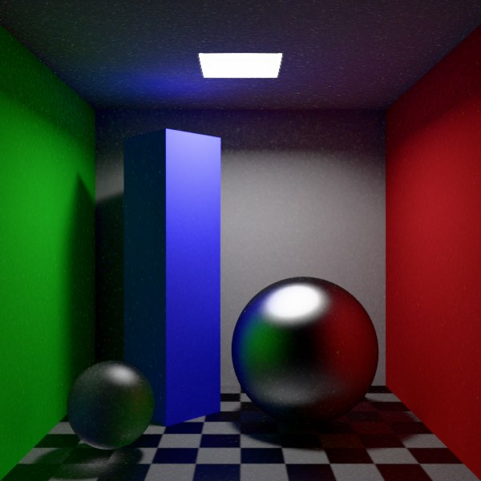
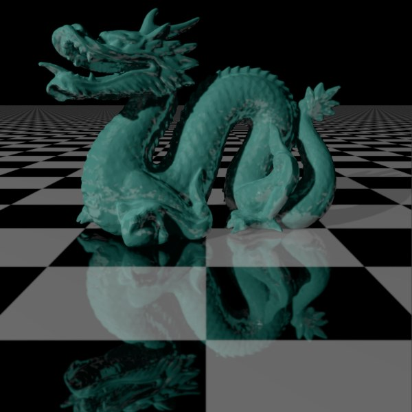
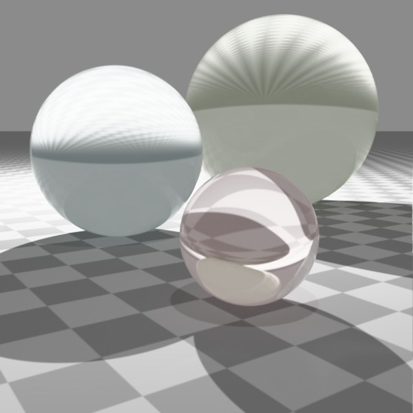
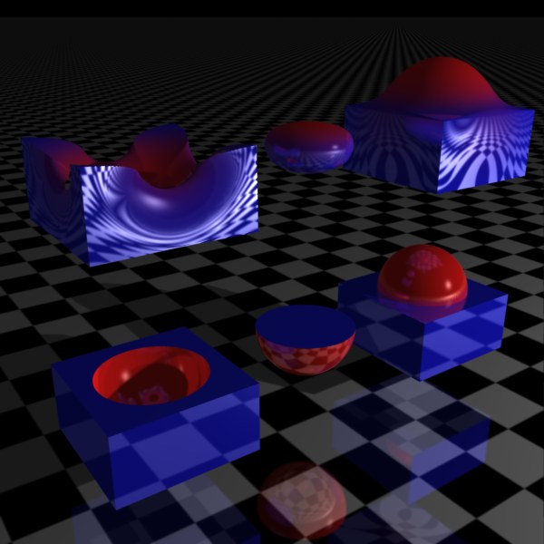
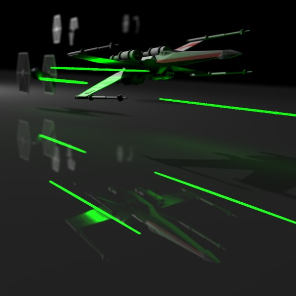
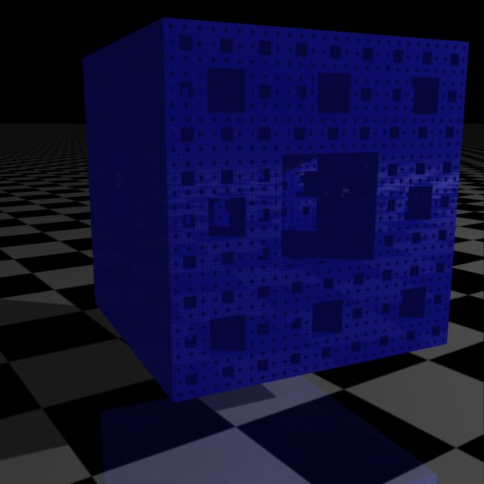
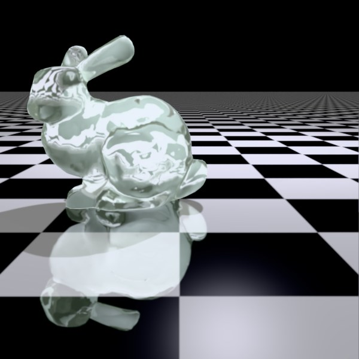
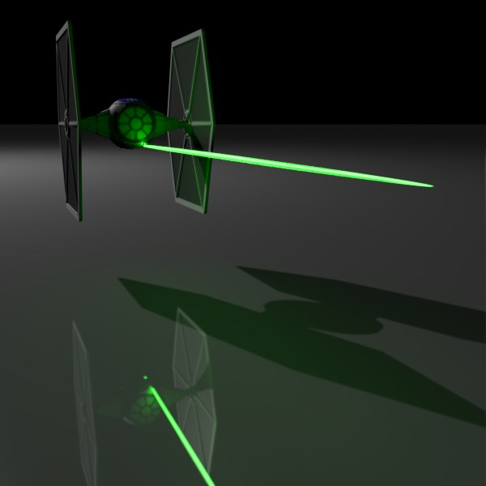

# JSRaytracer

**A path tracer that runs in your browser with no installs, no build step and no dependencies to fetch.**

Build a scene from plain JavaScript classes. JSRaytracer can then render it two ways: as a GLSL shader generated
for that scene and run in real time on your GPU, or as a multithreaded CPU tracer you can step through in a debugger.
Both renderers read the same scene graph, so the CPU tracer doubles as a reference implementation for the GPU one.

**[Try the GPU demo](https://alitteneker.github.io/jsraytracer/gl)** &nbsp;|&nbsp;
**[Try the CPU demo](https://alitteneker.github.io/jsraytracer/)**

<p align="center">
  <a href="https://alitteneker.github.io/jsraytracer/gl/?test=cornell_box_path"></a>
  <a href="https://alitteneker.github.io/jsraytracer/gl/?test=dragon"></a>
  <a href="https://alitteneker.github.io/jsraytracer/gl/?test=refraction_path"></a>
  <a href="https://alitteneker.github.io/jsraytracer/gl/?test=SDF_Combinations"></a>
  <br>
  <a href="https://alitteneker.github.io/jsraytracer/gl/?test=starwars"></a>
  <a href="https://alitteneker.github.io/jsraytracer/gl/?test=SDF_Menger"></a>
  <a href="https://alitteneker.github.io/jsraytracer/gl/?test=bunny"></a>
  <a href="https://alitteneker.github.io/jsraytracer/gl/?test=tie_fighter"></a>
</p>
<p align="center"><sub>Rendered on the GPU from scenes in <code>tests/</code>. Click one to open it in the demo.</sub></p>

---

## Highlights

- **Real-time on the GPU.** Each scene gets its own WebGL2 fragment shader, specialized for that scene's
  geometry, materials and BVH layout. Every frame adds another sample per pixel, so the image refines while you watch.
- **A 100,000-triangle dragon at about 2.6 ms per sample pass**, down from 6 ms after a round of traversal
  optimizations. See [Performance.md](Performance.md) for the full story.
- **Edit the scene live.** Click any object to select it, then drag it, rotate it, scale it or change its material,
  and the render keeps converging. That includes lights. Add spheres, boxes, planes and lights, or delete what's
  selected; with `?worldEditable=true` the shader is built to handle any scene, so these edits apply in milliseconds
  without recompiling. The World tree lists the scene's materials with how many primitives use each: assign one to
  an object, give an object its own copy ("Make unique"), or add, rename and delete them.
- **Lights you can see.** Area lights are part of the scene like any other object. Look at one directly, or in a
  mirror or through glass, and you see a glowing surface, consistent with the light it casts. Lights can be nested
  inside transformed groups like any other object.
- **Signed distance fields.** Build shapes from functional operators (unions, intersections, repetition,
  fractals like the Menger sponge and Sierpinski tetrahedron) and render them by ray marching, mixed freely with
  ordinary geometry.
- **Physically based materials.** A Principled-style material (base color, metallic,
  roughness, IOR, transmission) built from GGX microfacet lobes, with multiple scattering compensation so rough
  metals and glass keep their energy, as in Cycles. See [Materials.md](Materials.md).
- **Path tracing or Whitted-style.** Unbiased path tracing with next-event estimation and multiple importance
  sampling, or classic Whitted shading with exact reflection and refraction. Materials only describe surfaces (a
  BSDF); the integrator decides how light is transported.
- **Real assets.** Loads OBJ and MTL files with textures. Scenes can be serialized to JSON or MessagePack.

## The two renderers

| | GPU (WebGL2) | CPU (Web Workers) |
|---|---|---|
| Speed | Tens to hundreds of samples per second for most scenes | About a minute or less per sample pass |
| Interaction | Live editing of transforms, materials and lights | Render and view |
| Best for | Exploring scenes, look development, performance work | Debugging, checking the GPU's results against a reference |
| Entry point | [`gl/index.html`](gl/index.html) | [`index.html`](index.html) |

## Features

**Geometry**
- Spheres, planes, squares, circles, cylinders, unit boxes and triangles
- Triangle meshes from OBJ files, with MTL materials and textures
- Signed distance fields assembled from primitives and operators, intersected by ray marching
- Aggregates (groups with their own transforms, which can be nested) and instancing

**Acceleration**
- Bounding volume hierarchies built with the surface area heuristic (SAH)
- GPU traversal tuned for WebGL2: child bounding boxes stored with each parent so a missed child is never fetched,
  nearest-child-first visiting, power-of-two data texture layouts, Moller-Trumbore triangle tests, and shadow rays
  skipped when a light can't contribute

**Shading**
- Materials return a BSDF (lobes with `eval`, `sample` and `pdf`); integrators do the transport
- `PrincipledMaterial`: GGX metals, rough and smooth glass, and plastics (specular over diffuse), with Kulla-Conty
  and Turquin energy compensation
- The original Phong materials, with reflection, refraction and transmission, rendered exactly as before in Whitted
  mode
- Path tracing with next-event estimation, multiple importance sampling and Russian roulette, on both renderers
- Solid, checkerboard and texture-mapped material colors

**Lights**
- Point lights, and area lights in any supported shape (square, circle, sphere and more), sampled by area
- Directional lights: a point or shape whose transform is relative to the point being lit, so every point sees it
  in the same direction, like the sun. A shape gives soft shadows; the same power units apply, and shadows reach as
  far as the light's distance
- Physical units: a light's color times intensity is the power it emits
- Lights are scene objects: they can be hit by rays, picked and edited in the GPU editor, and placed inside groups
- Direct light sampling combined with visible emission, without counting any light twice

**Cameras and sampling**
- Perspective camera, with depth of field
- Incremental per-pixel multisampling with an optional denoising pass on the GPU

## Running it locally

Everything is static files. Any web server works. One is included:

```sh
python server.py        # serves the repository on http://localhost:8000
```

On Windows, `host.bat` does the same thing. Then open:

- `http://localhost:8000/gl/` for the GPU renderer and editor
- `http://localhost:8000/` for the CPU renderer

Pick a scene from the scene picker, or jump straight to one with `?test=<name>`, for example
`http://localhost:8000/gl/?test=dragon`. The **Editable Shader** checkbox in the Renderer panel (or
`&worldEditable=true` in the URL) switches to a shader that reads the scene from textures instead of compiling it in.
It renders a little slower, but adding and removing objects is then instant. Switching keeps the scene, the camera and
every edit made so far.

### Scenes

The `tests/` folder holds more than thirty scenes, listed in [`tests/list.json`](tests/list.json). A few to start with:

| Scene | What it shows |
|---|---|
| `ASimpleScene` | The basic geometry types under a single point light |
| `directional_light` | The same objects under a soft directional light |
| `refraction`, `diamond`, `bottle` | Glass and refraction |
| `cornell_box_path` | Path-traced global illumination from an area light |
| `pbr_materials` | Principled materials: plastic, gold and glass from smooth to rough |
| `BoxBall_DOF` | Depth of field |
| `bunny`, `dragon` | Large triangle meshes in a BVH |
| `starwars` | Instanced meshes, glowing laser bolts and depth of field together |
| `SDF_Menger`, `SDF_Sierpinski` | Fractals built from signed distance fields |

`dragon_json` and `toledo_json` load serialized versions of their scenes, which are too large to keep in the
repository. Generate them first with `cd tests && node test_to_json.js dragon` (or `toledo`, which also needs the
`@msgpack/msgpack` package).

## Writing a scene

A scene is a module in `tests/<name>/test.mjs` that hands back a renderer. Add its name to `tests/list.json` and it
appears in the scene picker. The picker shows `tests/<name>/preview.jpg` if there is one: render it with
`?renderAll=1&only=<name>&previews=true` (see below).

```js
export function configureTest(callback) {
    const camera = new PerspectiveCamera(Math.PI / 4, 1, Mat4.translation([0, 0, 5]));

    const objects = [
        new Primitive(new Sphere(),
            new PhongMaterial(Vec.of(0.1, 0.1, 1), 0.2, 0.4, 0.6, 100, 0.5)),
        new Primitive(new Plane(),
            new PhongMaterial(Vec.of(0.5, 0.5, 0.5), 0.1, 0.4, 0.6, 100, 0.5),
            Mat4.translation([0, -1, 0]).times(Mat4.rotation(Math.PI / 2, Vec.of(1, 0, 0)))),
        // Lights are scene objects too.
        new RandomSampleAreaLight(new Square(),
            Mat4.translation([0, 4, 0]).times(Mat4.rotation(Math.PI / 2, Vec.of(1, 0, 0))),
            Vec.of(1, 1, 1), 200)
    ];

    callback({
        renderer: new IncrementalMultisamplingRenderer(new World(objects), camera, 16, 4),
        width: 600,
        height: 600
    });
}
```

## Under the hood

```
src/        The scene model and CPU tracer: math, geometry, materials, BSDFs, integrators, lights, cameras,
            aggregates (BVH), SDFs, OBJ loading, serialization, and the Web Worker renderer.
gl/         The GPU renderer: adapters that walk the scene graph and generate GLSL for it, plus the editor UI.
gl/shaders/ The GLSL the adapters build each scene's shader from.
tests/      Example scenes, one folder each.
assets/     Models and textures used by the scenes.
```

The GPU side does not interpret the scene at runtime. Each adapter in `gl/src/` (world, geometries, materials,
lights) visits its part of the scene graph, packs the data into uniforms and data textures, and emits the GLSL that
reads it. For scenes that aren't being restructured, the generated shader is unrolled for that specific scene.

The fixed parts of that GLSL live in `gl/shaders/*.glsl`, loaded once by `gl/src/ShaderLibrary.js`. A file is split
into sections (`//#section name`), and an adapter renders a section with the few values only the scene knows, in one
of two ways, whichever reads better where it's used: `${name}` holes for generated code and array sizes, or
preprocessor macros tested with `#if` (the renderer's debug flags arrive as `DEBUG_*` macros this way). The code that
really is per-scene, such as the unrolled ray cast and each SDF's distance function, is still generated in the
adapters. `gl/src/ShaderGraph.js` derives the dependency graph between sections from the GLSL itself: with a
scene loaded, `ShaderGraph.report(jsrtEditor.renderer_adapter)` in the console lists which sections use which, and
the cycles that only prototypes break.

### Performance tooling

The GPU renderer has measurement tools built in, controlled by static flags or URL parameters:

- `?debugGPUTimer=true` logs the true GPU time per pass using timer queries, independent of vsync
- `?debugTraversalHeatmap=nodes` colors each pixel by BVH traversal work, with per-frame statistics
- `?bench=4&benchRef=compare&benchRefKey=<name>` runs a timed benchmark and checks the image against a saved
  reference, so an optimization can be proven not to change the picture

- `?renderAll=1` renders every scene in turn and downloads each as `<scene>.png`, for thumbnails and documentation.
  Options: `samples` (default 2048), `maxSeconds` per scene (default 120), `only=a,b`, `from=<scene>` to resume,
  `editable=true`, and `previews=true` to save `<scene>.preview.jpg` files for the scene picker instead (they go in
  `tests/<scene>/preview.jpg`). Keep the tab visible while it runs, and allow multiple downloads when the browser asks.

[Performance.md](Performance.md) covers what was measured, what changed and what didn't help.

## Roadmap

- Normal maps, tangents and glTF loading
- Clearcoat, sheen and the F82 metal Fresnel model
- Adding meshes and grouping objects from the editor
- Solid angle sampling for area lights
- Adaptive multisampling

## License

MIT. See [License.txt](License.txt).
